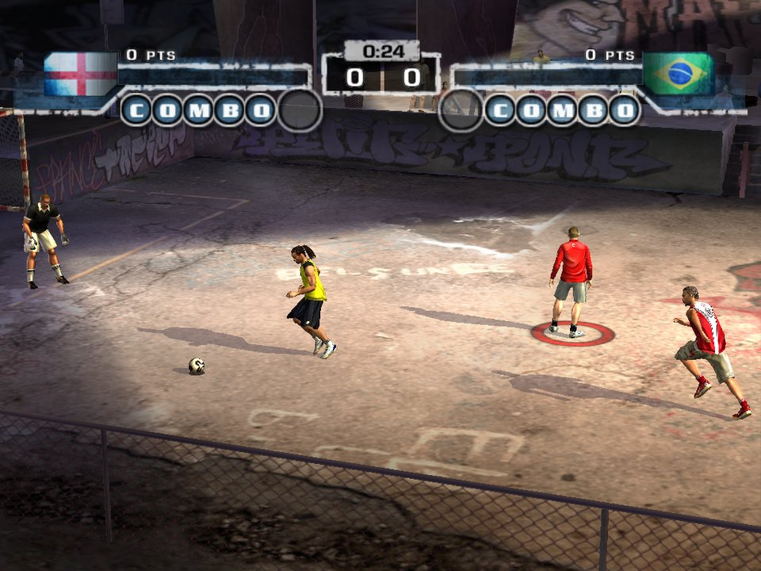
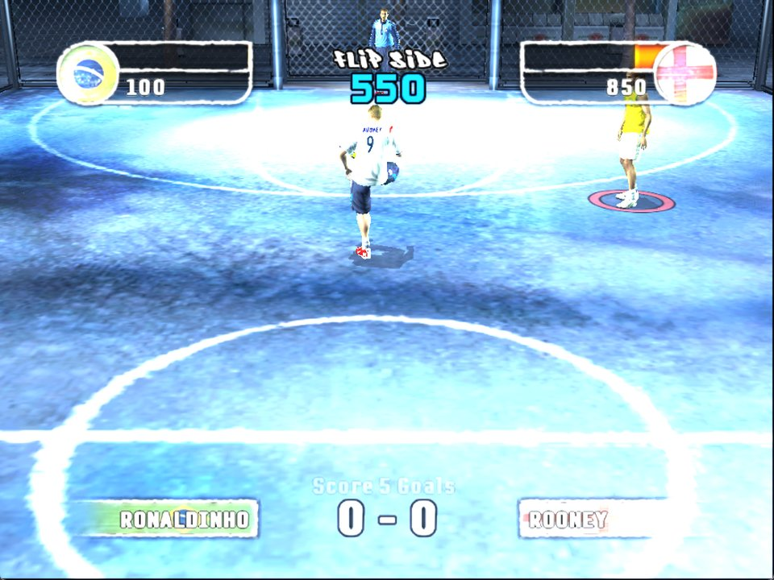
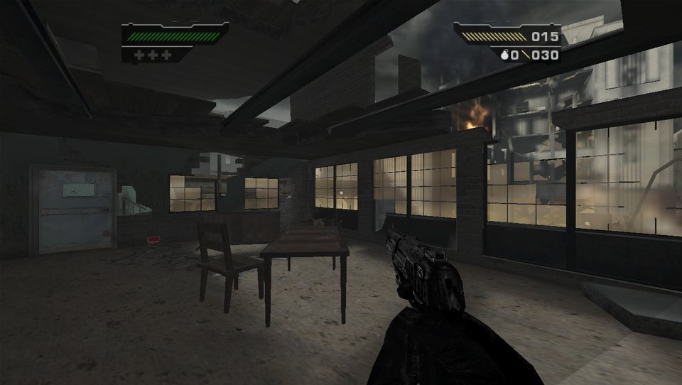
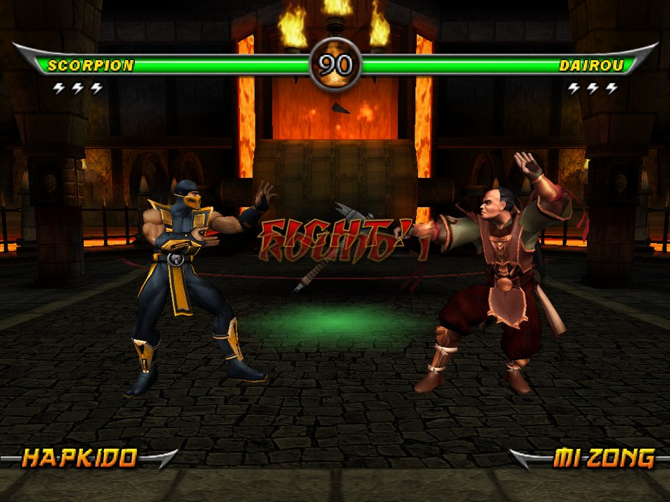

# xboxrecomp (fork with game ports)

**Download:** [Windows](https://github.com/batatinhafcbatatinha-pixel/xboxrecomp/releases/latest/download/xboxrecomp-windows.zip) (source + `Launcher.exe`: unzip, open `Launcher.exe`) · [Linux](https://github.com/batatinhafcbatatinha-pixel/xboxrecomp/releases/latest/download/xboxrecomp-linux.zip) · [macOS](https://github.com/batatinhafcbatatinha-pixel/xboxrecomp/releases/latest/download/xboxrecomp-macos.zip) (source only, LF line endings, no launcher: build as [docs/GETTING_STARTED.md](docs/GETTING_STARTED.md) says).

Fork of [sp00nznet/xboxrecomp](https://github.com/sp00nznet/xboxrecomp) (v0.13.1) with native PC ports of original-Xbox
games in [`games/`](games/) and a launcher that builds and starts them from **your own disc**. No game content (disc
image, executable, data or generated code) is in this repository.

## How to play a game

Windows 10/11 x64. About 10 GB free and 20-60 minutes for the first build of a game.

1. Get this repository, either way:
   - `git clone --recurse-submodules https://github.com/batatinhafcbatatinha-pixel/xboxrecomp.git`, or
   - **Code > Download ZIP** and unpack it, or
   - only [`Launcher.exe`](https://github.com/batatinhafcbatatinha-pixel/port-installer/releases/latest/download/Launcher.exe):
     run it, pick xboxrecomp and a folder, and it downloads this repository there.
2. Run **`Launcher.cmd`** (it downloads `Launcher.exe` from the
   [port-installer releases](https://github.com/batatinhafcbatatinha-pixel/port-installer/releases) the first time).
3. Click **CHOOSE ISO...** and pick your disc image (XISO or full Redump `.iso`). The game is recognised from its `default.xbe`.
4. Confirm **Install**. The launcher installs what is missing (Python, Visual Studio C++ Build Tools, LLVM/Clang, CMake,
   Ninja), copies and checks the game files, translates the game code and compiles it. Finished steps are skipped next
   time. Log: **Install** tab and `games/<game>/setup-log.txt`.
5. **PLAY**. **PC settings** in the launcher, or the in-game F1 menu: display mode, monitor, refresh rate, V-Sync,
   frame limit, resolution, controls, language, volume.

| Game | Disc | State |
| --- | --- | --- |
| [FIFA Street](games/street1/) | Xbox, USA and Europe | playable |
| [FIFA Street 2](games/street2/) | Xbox, USA | playable |
| [Black](games/black/) | Xbox, USA | playable |
| [Mortal Kombat: Armageddon](games/mka/) | Xbox, USA | early work, not in the launcher yet |

Only these exact discs are supported (checked by SHA-256, see each `games/<game>/installer.json`).

## Differences from upstream

- `games/`: game profiles (recompiler config, native game code, build and play scripts)
- `hle/d3d8/`: one shared Direct3D 8 / DirectSound / input HLE (native Direct3D 11 renderer, PC settings menu, native audio)
- launcher + one-click install/build/play (`Launcher.cmd`, [port-installer](https://github.com/batatinhafcbatatinha-pixel/port-installer) submodule in `tools/port-installer`)
- NV2A: D3D11 compute path, vertex shader translation, push-buffer executor
- APU: DSP from xemu (GP/EP), XAudio2 and SDL2 output
- kernel: title KEVENTs, guest events, threads, memory layout, overridable kernel data/stack bases, guest-write hook around NtReadFile
- input: XInput and OHCI updates, non-XInput pads through run-time SDL3
- platform: POSIX side of the Win32 compatibility layer, MMIO decoding
- recompiler: guest CPU yield hooks at backward branches, lifter fixes

## Building

Windows: Visual Studio 2022 (or Build Tools) with the C++ workload and Windows SDK, LLVM/Clang 20+, CMake 3.25+, Ninja,
Python 3.11+ (the launcher puts LLVM, CMake and Ninja in `.local/tools`).

One game, without the launcher (same steps it runs; `-Source` is your disc image):

```bat
git clone --recurse-submodules https://github.com/batatinhafcbatatinha-pixel/xboxrecomp.git
cd xboxrecomp
powershell -ExecutionPolicy Bypass -File tools\port-installer\setup\setup.ps1 -GameDir games\street2 -ToolsDir .local\tools -Source "D:\ISO\your-disc.iso"
```

Or by hand inside `games/<game>/`: the `steps` of its `setup.json` (each game's `README.md` has the details), then its
`Play-*.cmd`. The toolkit itself builds as the upstream documentation describes (see [Upstream](#upstream)).

## Screenshots

Each port at the furthest point it reaches today.

<table>
  <tr>
    <td align="center" width="50%">
      <br>
      <b>FIFA Street</b><br>
      <sub>Xbox &middot; a match, England against Brazil</sub>
    </td>
    <td align="center" width="50%">
      <br>
      <b>FIFA Street 2</b><br>
      <sub>Xbox &middot; a match, Brazil against England</sub>
    </td>
  </tr>
  <tr>
    <td align="center" width="50%">
      <br>
      <b>Black</b><br>
      <sub>Xbox &middot; mission 1, Veblensk</sub>
    </td>
    <td align="center" width="50%">
      <br>
      <b>Mortal Kombat: Armageddon</b><br>
      <sub>Xbox &middot; a fight, Scorpion against Dairou</sub>
    </td>
  </tr>
</table>

## Upstream

This repository is a fork of [sp00nznet/xboxrecomp](https://github.com/sp00nznet/xboxrecomp); its documentation (pipeline, runtime, tools) is
in that project's README and in `docs/`. The original license and credits apply unchanged.

## License

The repository's own code is under the MIT license ([LICENSE](LICENSE)). It also carries code from xemu under
LGPL-2.1-or-later and, in `src/apu/dsp/`, a DSP interpreter under GPL-2.0-or-later (files, authors and revision
in [NOTICE](NOTICE) and `src/apu/dsp/UPSTREAM.md`). **A binary that links the audio processing library (`xbox_apu`), and with it
that interpreter, is distributed under GPL-2.0-or-later**; the MIT terms alone apply only to a build without
`src/apu/dsp/interp`.
